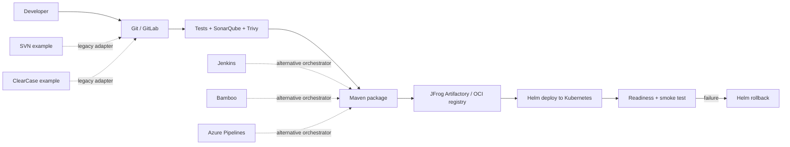

# Enterprise Multi-Tool CI/CD Automation Platform

A portfolio-ready reference implementation for a Java Spring Boot service with repeatable CI/CD examples across Jenkins, GitLab CI/CD, Bamboo, and Azure DevOps. The core path uses GitLab/Git and Maven; legacy SCM examples for SVN and IBM ClearCase are documented separately rather than forcing them into one production pipeline.

> **Scope note:** This repository is an extensible demo/reference platform, not a pre-connected enterprise deployment. Configure your own registry, Artifactory, SonarQube, Kubernetes cluster, AWS account, and CI credentials before enabling publishing or deployment stages. Never commit secrets.

## Architecture



## Repository layout

- `app/` — Spring Boot REST API and unit tests
- `Dockerfile` — non-root, multi-stage container build
- `.gitlab-ci.yml` — GitLab pipeline with test, quality, scan, image, and deploy stages
- `Jenkinsfile` — Jenkins declarative pipeline
- `bamboo-specs/` — Bamboo Specs Java plan example
- `azure-pipelines.yml` — Azure DevOps pipeline
- `docker-compose.yml` — local development with optional SonarQube
- `helm/enterprise-demo/` — Kubernetes Helm chart
- `k8s/` — plain Kubernetes deployment/service manifests
- `scripts/` — smoke test and deployment helper
- `examples/scm/` — SVN and ClearCase adapter examples
- `docs/` — setup, secrets, troubleshooting, release, and rollback guidance

## Application API

| Method | Endpoint | Purpose |
|---|---|---|
| GET | `/` | Service metadata |
| GET | `/api/hello` | Simple smoke-test endpoint |
| GET | `/actuator/health` | Health probe |

## Run locally

Prerequisites: JDK 17+, Maven 3.9+, Docker (optional).

```bash
cd app
mvn test
mvn spring-boot:run
```

Then open `http://localhost:8080/api/hello` and `http://localhost:8080/actuator/health`.

Build a container from the repository root:

```bash
docker build -t enterprise-demo:local .
docker run --rm -p 8080:8080 enterprise-demo:local
```

Or use Docker Compose:

```bash
docker compose up --build
```

## CI/CD overview

1. Compile and run unit tests.
2. Run SonarQube analysis when configured.
3. Run Trivy filesystem and image scans.
4. Build and publish a versioned JAR / container image to your chosen repository.
5. Deploy with Helm to Kubernetes only from a protected branch/environment.
6. Verify readiness and roll back on failed verification.

CI examples are intentionally parameterized. Set the variables documented in `docs/CONFIGURATION.md`. For a safe first run, disable deploy jobs and use a local image tag.

## Resume-ready project summary

**Enterprise Multi-Tool CI/CD Automation Platform** — Built a Spring Boot service and reusable CI/CD reference pipelines for Jenkins, GitLab CI/CD, Bamboo, and Azure DevOps; automated Maven tests, SonarQube quality gates, Trivy security scanning, versioned artifact/container publishing, and Helm-based Kubernetes deployment with readiness checks and rollback guidance. Added isolated SVN and ClearCase legacy SCM integration examples.

Only claim tools and outcomes you personally configure and demonstrate. Add measured numbers (build duration, scan findings resolved, deployment success rate) after collecting real results.

## Important safety defaults

- Do not store passwords, access tokens, AWS keys, kubeconfigs, or private keys in Git.
- Use CI secret stores and short-lived identity where supported.
- Restrict deploy permissions to protected branches/environments.
- Use immutable image tags (commit SHA/release version), not only `latest`.
- Trivy is configured to fail on HIGH/CRITICAL findings in examples; tune policy consciously.
